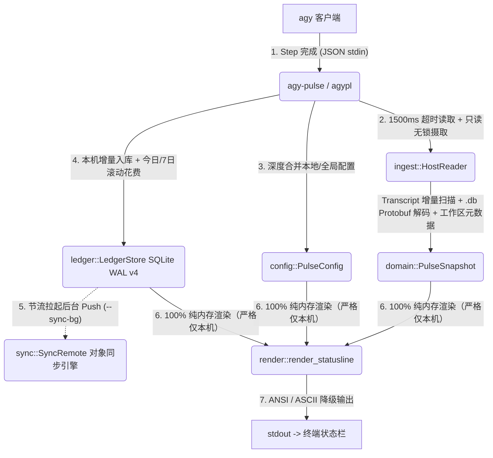

# agy-pulse 系统架构与数据流

> **版本：** 2.1.0  
> **更新说明：** 对齐单一原生 Rust 二进制深模块架构（[ADR-0001](./adr/0001-rust-single-binary-v2.md)、[ADR-0002](./adr/0002-remove-cloud-quota-requests.md)、[ADR-0003](./adr/0003-deep-module-single-crate.md)、[ADR-0004](./adr/0004-multi-device-object-sync.md)、[ADR-0005](./adr/0005-dashboard-local-config-management.md)、[ADR-0006](./adr/0006-thin-statusline-collector-and-inmem-wal.md)）

## 概览

`agy-pulse` 是为 [Antigravity CLI](https://antigravity.google)（`agy`）打造的原生单二进制 Rust **状态栏**、**上下文压缩**监控、统一 SQLite WAL **账本**报表（`stats`）与本地**网页看板**（`dashboard`）工具。

`agy` 在每次模型步骤完成后调用 `settings.json` 中注册的 `statusLine.command` 并通过 `stdin` 传入 JSON。`agy-pulse` 在 **1500 ms** 硬超时保护下输出多行 ANSI/ASCII 文本并始终以退出码 `0` 结束，Linux x86_64 Release 二进制冷启动仅 ~4 ms，彻底告别 Node.js、Python 与外部 `sqlite3` 依赖。

---

## 高层数据流

---

## 九大高内聚深模块与依赖流

1. **`domain`（纯内存领域内核，零 I/O）**：定义 `PulseSnapshot`、**任务树（Cascade）**、**单窗对话（Conversation）**、**账号（Account）**、**设备（Device）**与**配额快照（Quota Snapshot）**模型；收口全仓唯一字数归一化与费用计算（`accounting.rs` / `pricing.rs`，完整计入 `f4.f1` 系统提示词与 >200k 长上下文阶梯定价）以及**模型配额**临界窗口计算（`quota.rs`）。
2. **`ingest`（宿主只读摄取器，`HostReader`）**：统一收口宿主 `stdin` JSON 归一化、64MB 大 `transcript.jsonl` 字节偏移增量扫描（含 `transcript_full.jsonl` 回查）、纯文件 `.git/HEAD` 读取与工作区规则/MCP 统计，以及宿主 `.db` 无锁只读读取（静态库 `?immutable=1`，活跃 `-wal` 拷贝主库+伴生文件至临时目录）与私有 Protobuf 解码（`proto_wire.rs`）。
3. **`ledger`（统一 SQLite WAL 账本，`LedgerStore` Schema v4）**：内嵌 `rusqlite`（`bundled` + WAL + `busy_timeout`）管理 `agy-pulse-ledger.sqlite`；在 `ingested_dbs` 与 `telemetry_steps` 上以 `account_id`、`device_id`（含索引 `idx_steps_device_ts`、`idx_steps_account_device_ts`）隔离本机与远端记录，新增 `sync_devices`、`quota_snapshots`、`sync_chunk_state` 三张同步表并在 `ledger_meta` 持久化 `local_device_id`、`last_observed_email`、`last_sync_push_ms`、`last_sync_pull_ms`、`last_sync_error` 与 `last_sync_remote_fingerprint`；`rolling_cost_cursors` 保持严格本机语义不被远端 Pull 修改；依赖 `ingest`、`domain`、`sync`（读取同步配置构建 `syncStatus`）、`config`、`render` 与 `platform`。
4. **`sync`（多机对象同步深模块，[ADR-0004](./adr/0004-multi-device-object-sync.md)）**：暴露统一 `SyncRemote` 对象存储契约（`probe`、`list`、`get`、`put`、`delete`），内置 `local_dir`、`webdav`（`ureq`）、`s3`（纯 Rust HMAC-SHA256 SigV4，零 OpenSSL）与 `cf_worker`（对应 `deploy/cloudflare-worker/`）4 种后端；采用**按设备单写、按账号读合并**的 Wire Format v1（`<prefix>/accounts/<account_key>/devices/<device_id>/manifest.json` + 按 UTC 月分片的 `chunks/YYYY-MM.jsonl.gz`，凭 SHA-256 跳过未变历史月份，载荷严格不含对话正文、`workspace` 与 `branch`）；状态栏热路径按需脱离拉起 `agy-pulse --sync-bg`（受 `agy-pulse-sync.lock` 排他锁、15s 单次 HTTP 超时与 45s 硬看门狗保护）；依赖 `ledger`、`domain` 与 `platform`。
5. **`render`（纯内存排版引擎，零 I/O）**：`render_statusline` 接收领域快照、`PulseConfig` 与 `TerminalCaps`，完成五级平滑上下文条、分模型累计缓存行、厂商配额表/紧凑条、东亚宽字符/Emoji 安全截断及中英文双语输出。
6. **`config`（配置管理与交互式向导）**：按 `内置默认值 → 全局配置 → 工作区配置 → 环境变量` 深度合并（静默忽略已退役 v1 字段），提供跨平台原生原始终端向导 `agypl config` 与共享**状态栏**预览接口（实时调用 `render::render_statusline`），支持保留未知字段的全局原子保存（`save_global_pulse_config_preserving_unknown`）与环境变量覆盖元数据探测；与 `sync` 的全局 `0600` 私有配置 `agy-pulse-sync.json` 彻底隔离。
7. **`dashboard`（本地回环网页看板、保活、异步拉取与双配置管理，[ADR-0005](./adr/0005-dashboard-local-config-management.md)）**：强制绑定 `127.0.0.1` 并校验 `Host` / `Origin` 与 CSP 头；编译期 `include_str!` 内嵌零 CDN 单页前端（支持 `/` 与 `/settings`、`/settings/sync` 直达视图路由）；采用 `/api/keepalive` SSE + `/api/ping` + `pagehide` `/api/disconnect` 页面生命周期保活状态机；遵循“秒开本地**账本** + 非阻塞异步拉取”策略——`GET /api/overview` 立即返回本机与已缓存远端数据，前端异步请求 `POST /api/sync-remote`（服务端 30s 节流，支持 `?force=1` / `{"force":true}`）执行 Pull + Push 并无感刷新；内设 `dashboard::config_api` 深模块承载独立「设置」页面的 `/api/config/*` 接口——启动生成 32 字节（64 位十六进制）进程级 CSRF Token 注入页面并强制校验 `X-Agy-Pulse-Token` 与严格同源，**偏好配置**仅读写全局文件并深合并保留未知字段、复用 Rust 引擎实时预览**状态栏**，**同步配置**严格实行凭据只写不回显（`keep`/`set`/`clear` + `redact_sync_error_message` 脱敏 + 环境变量永不反写落盘），两套配置均受独立 `Mutex` 与文件 SHA-256 `409 Conflict` 乐观锁保护并在保存/删除后即时刷新 `LedgerRuntime.sync_options` 身份提示；依赖 `sync`、`ledger`、`config`、`render` 与 `platform`。
8. **`ops`（安装、卸载、账号归属与 GitHub 更新）**：`install` 部署双入口二进制并原子配置 `settings.json`（损坏先备份 `.bak`）；`uninstall` 清理注册项、快捷方式与缓存并默认保留**账本**；`account assign` 将本机 `unassigned` 存量记录归属到指定邮箱；`updater` 仅在显式命令或 24h 后台检查时请求 GitHub Releases，拒绝 `https -> http` 降级重定向并强制校验 `SHA256SUMS`；依赖 `ledger`、`dashboard` 与 `platform`。
9. **`platform`（跨平台系统调用隔离层）**：全仓唯一允许 `#[cfg(unix)]` / `#[cfg(windows)]` 条件编译的底层适配模块，封装路径解析（含 `AGY_PULSE_SYNC_CONFIG`）、不可变 `device_id` 生成、`0700`/`0600` 权限控制、TTY 探测与原始输入守卫、后台守护进程脱离、Windows 运行中 `.exe` 改名热替换及桌面快捷方式生成。
