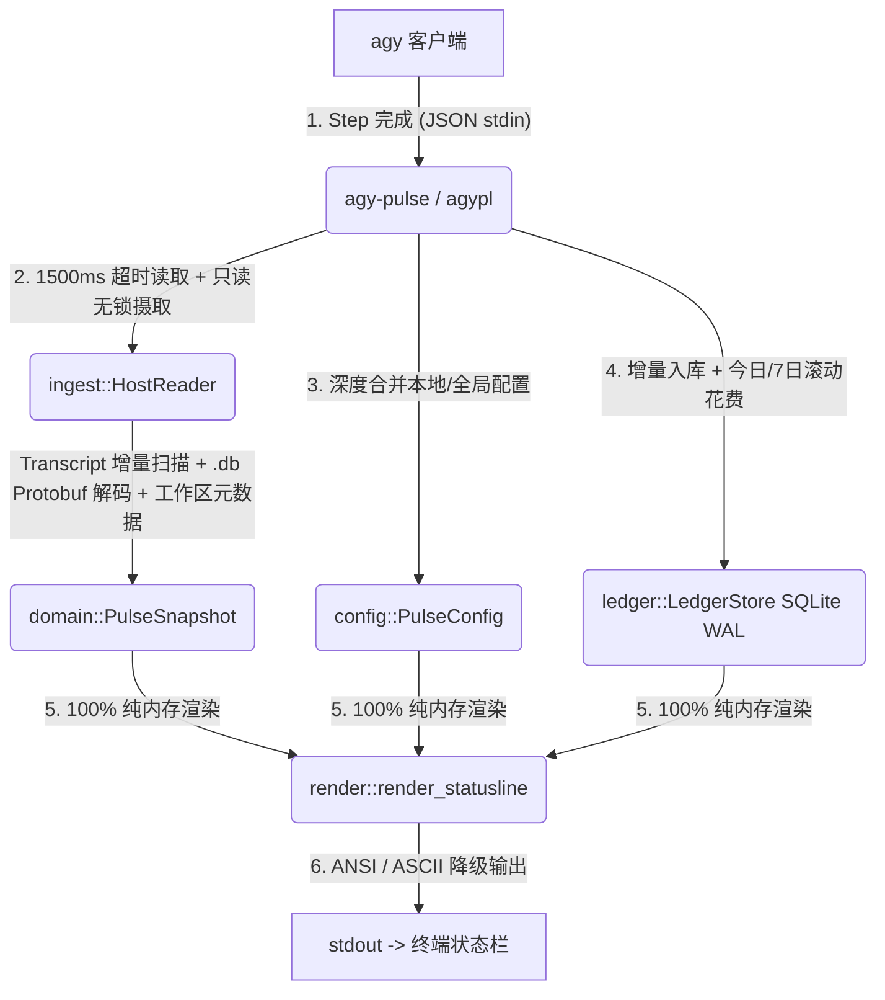

# agy-pulse 系统架构与数据流

> **版本：** 2.0.0  
> **更新说明：** 对齐单一原生 Rust 二进制深模块架构（ADR-0001、ADR-0002、ADR-0003）

## 概览

`agy-pulse` 是为 [Antigravity CLI](https://antigravity.google)（`agy`）打造的原生单二进制 Rust **状态栏**、**上下文压缩**监控、统一 SQLite WAL **账本**报表（`stats`）与本地**网页看板**（`dashboard`）工具。

`agy` 在每次模型步骤完成后调用 `settings.json` 中注册的 `statusLine.command` 并通过 `stdin` 传入 JSON。`agy-pulse` 在 **1500 ms** 硬超时保护下输出多行 ANSI/ASCII 文本并始终以退出码 `0` 结束，Linux x86_64 Release 二进制冷启动仅 ~4 ms，彻底告别 Node.js、Python 与外部 `sqlite3` 依赖。

---

## 高层数据流

---

## 八大高内聚深模块（单向无环 DAG）

1. **`domain`（纯内存领域内核，零 I/O）**：定义 `PulseSnapshot`、**任务树（Cascade）**与**单窗对话（Conversation）**模型；收口全仓唯一字数归一化与费用计算（`accounting.rs` / `pricing.rs`，完整计入 `f4.f1` 系统提示词与 >200k 长上下文阶梯定价）以及**模型配额**临界窗口计算（`quota.rs`）。
2. **`ingest`（宿主只读摄取器，`HostReader`）**：统一收口宿主 `stdin` JSON 归一化、64MB 大 `transcript.jsonl` 字节偏移增量扫描（含 `transcript_full.jsonl` 回查）、纯文件 `.git/HEAD` 读取与工作区规则/MCP 统计，以及宿主 `.db` 无锁只读读取（静态库 `?immutable=1`，活跃 `-wal` 拷贝主库+伴生文件至临时目录）与私有 Protobuf 解码（`proto_wire.rs`）。
3. **`ledger`（统一 SQLite WAL 账本，`LedgerStore`）**：内嵌 `rusqlite`（`bundled` + WAL + `busy_timeout`）管理 `agy-pulse-ledger.sqlite`，合并自动扫描 CLI 与 Antigravity IDE 双源 `conversations/*.db`，提供防压缩倒扣的今日/近 7 日滚动费用、`agypl stats` 终端报表与 CSV/JSON 导出。
4. **`render`（纯内存排版引擎，零 I/O）**：`render_statusline` 接收领域快照、`PulseConfig` 与 `TerminalCaps`，完成五级平滑上下文条、分模型累计缓存行、厂商配额表/紧凑条、东亚宽字符/Emoji 安全截断及中英文双语输出。
5. **`config`（配置管理与交互式向导）**：按 `内置默认值 → 全局配置 → 工作区配置 → 环境变量` 深度合并（静默忽略已退役 v1 字段），提供跨平台原生原始终端向导 `agypl config`（实时调用 `render` 预览，临时文件+原子重命名保存）。
6. **`dashboard`（本地回环网页看板与保活）**：强制绑定 `127.0.0.1` 并校验 `Host` / `Origin` 与 CSP 头；编译期 `include_str!` 内嵌零 CDN 单页前端；采用 `/api/keepalive` SSE + `/api/ping` + `pagehide` `/api/disconnect` 页面生命周期保活状态机，后台切标签/最小化永不断连，所有页面真正关闭后自动回收退出；支持独立 `--app` 小窗与带指纹的桌面快捷方式。
7. **`ops`（安装、卸载与 GitHub 更新）**：`install` 部署双入口二进制并原子配置 `settings.json`（损坏先备份 `.bak`）；`uninstall` 清理注册项、快捷方式与缓存并默认保留**账本**；`updater` 仅在显式命令或 24h 后台检查时请求 GitHub Releases，拒绝 `https -> http` 降级重定向并强制校验 `SHA256SUMS`。
8. **`platform`（跨平台系统调用隔离层）**：全仓唯一允许 `#[cfg(unix)]` / `#[cfg(windows)]` 条件编译的底层适配模块，封装路径解析、TTY 探测与原始输入守卫、后台守护进程脱离、Windows 运行中 `.exe` 改名热替换及桌面快捷方式生成。
