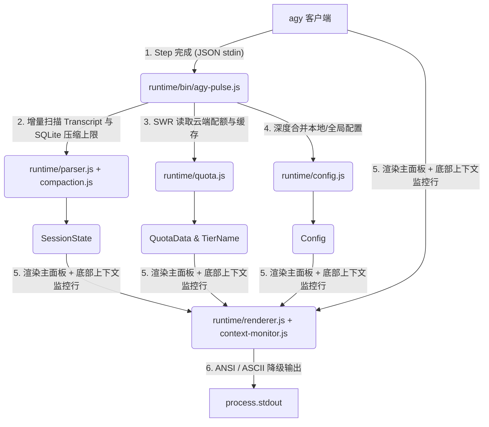

# agy-pulse 系统架构与数据流

> **版本：** 1.0.0  
> **更新说明：** 对应纯 Node.js 单进程一体化架构

## 概览

`agy-pulse` 是为 [Antigravity CLI](https://antigravity.google)（`agy`）打造的全能单进程状态栏插件。它将多行工作区信息与云端配额面板，以及 `agy-statusline` 的服务端真实压缩上限解码、增量日志扫描和实时上下文监控行全部原生整合进单个 Node.js 进程，彻底消除 Python + Bash 双进程胶水与外部 npm 依赖。

---

## 高层数据流

---

## 核心模块与技术亮点

1. **原生 Protobuf 与 SQLite 压缩上限及分模型性能统计（`runtime/compaction.js`）**
   - 直接读取 `<antigravityRoot>/conversations/<conversation_id>.db` 中的 `gen_metadata`（`f1.f9.f10.f4` 压缩上限；`f1.f4.f3`、`f1.f11` TTFT、`f1.f12` 流式耗时与模型标识）与 `executor_metadata`（`f10.f2.f5`），使用 `BigInt` 移位避免 JS 32 位整数溢出。
   - 对最近 30 个会话 `.db` 库滑动聚合各模型纯流式加权均速（`∑outputTokens / ∑streamingDuration`）与平均首字延迟（TTFT），使新开会话与活跃蜂群子代理均可立即可见历史均速与首字参考。
   - 优先使用 Node.js 内置 `node:sqlite` 只读打开，不可用时回退临时副本或 `sqlite3` CLI；缓存签名同时包含 `.db` 与 `.db-wal` 的 `size:mtimeMs`（`_db_limits` 上限 24 条、`_db_perf` 上限 36 条），防止 WAL 覆写碰撞。
2. **字节偏移增量 Transcript 解析（`runtime/parser.js`）**
   - 在 `transcript-cache/<sha256>.json` 中持久化字节偏移量与增量统计（`compactionCount`、`totalOutputTokens`、`lastTurnUsage`、`turnHistoryMaxByMode`），并在 `PLANNER_RESPONSE` 遇到 `SYSTEM_MESSAGE` / `USER_INPUT` 时准确闭合耗时。
   - 非 Git 目录 `branch` 返回 `null`，渲染层不再伪造 `⎇ main`。
3. **实时上下文监控底栏（`runtime/renderer/context-monitor.js`）**
   - 当 `display.showContextMonitor` 为 `true`（默认配置开启）时，在配额面板下方紧贴输出五级平滑进度条（`█▓▒░·`，非 UTF-8 终端自动降级为 `#=-.`）、真实压缩上限占比、压缩次数与历史峰值、单轮缓存命中率及 `>=85%` 即将触发压缩红色粗体警报。
   - 归一化处理 cache-inclusive / exclusive 模型，当 `agyData.context_window.current_usage` 缺失、为 `{}` 或全零时自动回退 `state.lastTurnUsage`。
4. **跨平台配置、配额与生命周期（`brand.js`、`config.js`、`statusline-installer.js`、`uninstall.js`、`bootstrap.js`）**
   - `config.js` 支持 `agy-pulse.config.json`，按 `FULL_DEFAULT_CONFIG` 深度合并并按传入的 `targetCwd` 加载项目级配置；`enabled === false` 时 `agy-pulse.js` 与 `renderer.js` 静默退出。
   - `bootstrap.js` 尊重 `AGY_PULSE_DATA_DIR`，升级时保留并深度合并用户已保存的全局配置（支持 `--reset-config` 重置），清理旧版 `skills/hud-config` 残留，并支持 `--cleanup-self` 安全自清理。
   - `statusline-installer.js` 保留 `settings.json` 中已有的 `enabled` / `stack_with_default` 属性，JSON 损坏时先备份 `.bak`，并修复 Windows `.cmd` shim（含 `%LocalAppData%\Programs\nodejs\node.exe`）与 `AGY_PULSE_NODE` 垫片回退。
   - `uninstall.js` 统一清理 `agy-pulse-runtime`、主/次级 `settings.json`、`plugin_data/agy-pulse`、`statusline-combined.sh`、全部缓存文件与 `os.tmpdir()` 临时残留。
