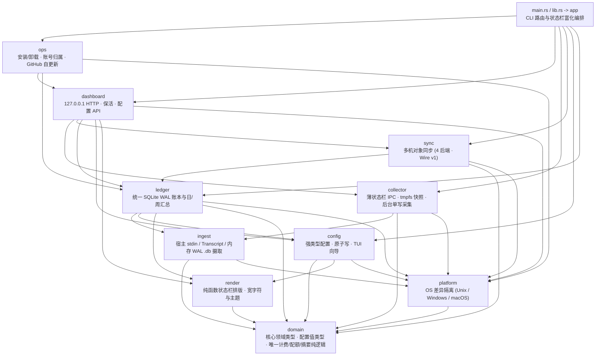

# agy-pulse v2.0.0（Rust 重写）共识归档与深模块架构蓝图

> 状态：**已定稿归档（待启动实现）**
> 关联文档：[GLOSSARY.md](../GLOSSARY.md) · [ADR-0001](adr/0001-rust-single-binary-v2.md) · [ADR-0002](adr/0002-remove-cloud-quota-requests.md) · [ADR-0003](adr/0003-deep-module-single-crate.md)

---

## 一、 核心重写共识归档

### 1. 系统边界与裁剪对照

| 维度 | v1.0（Node.js 现行版） | v2.0（Rust 重写定稿） |
|---|---|---|
| **本地运行时与 CLI** | 29 个 JS 模块，强依赖本机 `Node.js >= 22.5` 与外部 CLI 回退，空载冷启动 ~125ms+ | **单一原生静态 Rust 二进制**（`agy-pulse` / `agypl`），零外部运行时依赖，目标冷启动 <10ms |
| **宿主插件静态层** | `plugin.json`、`gemini-extension.json`、`skills/pulse-config/SKILL.md` | **原样保留**（满足 `agy plugin install` 静态声明协议） |
| **反重力 / Google 云端配额** | 提取系统钥匙串/OAuth 文件并伪造客户端请求头调私有接口（存在违反 ToS 封号风险） | **彻底物理移除**（连同 Token 提取与 `diagnose` 云端鉴权子命令一并移除）；配额 100% 消费宿主 `stdin` 官方传入数据 |
| **网页看板（Dashboard）** | 零依赖单页 HTML/CSS/JS；窗口最小化/切后台 10 分钟即停发心跳导致服务自杀断连 | 原有零依赖前端通过 `include_str!` 静态内嵌进二进制；保留桌面图标与独立小窗；**改为只要网页未关闭（含最小化/后台标签）即保持在线，仅在页面彻底关闭后自动退出** |
| **计费与展示粒度** | 状态栏与账本在系统提示词、缓存字数上存在多套冲突公式；`Session` 一词三义 | 保持“**状态栏**极简看汇总、**网页看板**展开看**任务树（Cascade）**子代理细分”；**全局收口为唯一计费与字数公式** |
| **历史数据升级** | 维护 SQLite 账本 + JSON 降级账本 + 独立 `daily-cost.json` 文件锁 | **仅保留兼容读取 `agy-pulse.config.json` 用户配置**；不写旧账本/缓存兼容迁移代码，升级后直接重新扫描宿主原始对话记录重建账本 |
| **分发与自更新** | GitHub raw 33 个脚本拉取 + npm 包；后台 24h 查 GitHub 更新 + `agypl update` | **GitHub Releases 5 平台预编译二进制**（Win x64、macOS 双芯、Linux 双芯 musl 静态版）+ `install.sh`/`install.ps1` + `cargo install`（**移除 npm 包**）；保留 GitHub 新版提示与手动 `agypl update` |
| **切流验收门槛** | JS 白盒单测为主 | 同仓渐进开发，满足 **JS↔Rust 黄金样本对拍一致 + 5 平台测试全绿 + 本机实盘试用通过** 后清理全部老 JS 代码发布 `v2.0.0` |

---

## 二、 为什么 v1 会长成“大泥球”，以及 v2 如何从根源防屎山

复盘 v1 源码，导致维护困难的 4 个结构性病灶及 v2 的根治手段如下：

1. **病灶 1：多职责纠缠耦合，牵一发而动全身**
   - *v1 现状*：`parser.js` 把增量读文件、跑 `git` 子进程、扫工作区规则、调 SQLite、算子代理速率缓存五种完全无关的变化原因耦合在一起，改一处极易波及其他链路。
   - *v2 根治*：**高内聚、低耦合（按“单一变化原因”内聚模块，模块间仅通过纯数据值对象解耦通信）**——不设机械的单文件行数上限，同一内聚职责保持完整不硬拆；不同模块（摄取、账本、计费、渲染）之间绝不传递底层连接句柄或内部状态，改一处实现不影响上下游。
2. **病灶 2：同一业务规则散落多处、各自为政**
   - *v1 现状*：Token 含不含缓存、加不加系统提示词在 `cost.js`、`format.js`、`compaction.js`、`ledger.js` 里写了 4 套近似逻辑；打开宿主 SQLite 在 `ledger.js` 写了无锁快照，在 `compaction.js` 却漏写导致锁冲突。
   - *v2 根治*：**高局部性（Locality）单点收口**——计费与字数口径全仓只允许出现在 `domain::accounting`；宿主 `.db` 无锁只读打开与 Protobuf 解码全仓只允许出现在 `ingest` 内部私有子模块。
3. **病灶 3：为了单测把内部管道暴露成满天飞的可选参数（浅模块）**
   - *v1 现状*：内部函数到处透传 `_execFileSync`、`sqliteModule` 等白盒钩子，改一行实现碎十几个单测。
   - *v2 根治*：**深模块设计（Deep Modules — 极窄公开接口隐藏复杂实现）**——不造单实现的假想 Trait；测试与业务调用方走完全相同的模块公开接口，存储与摄取直接用 `tempfile::TempDir` 真实临时目录 + 真实内嵌 SQLite 测试。
4. **病灶 4：无类型松散字典层层兜底**
   - *v1 现状*：`a?.b ?? c?.d ?? 0` 在渲染与计费层重复十几次。
   - *v2 根治*：在 `ingest` 入口一次性将外部脏异构 JSON/Protobuf 归一化为强类型领域快照（`PulseSnapshot` / `ConversationDelta`），下游模块只接收干净、不变量已确立的 Rust 结构体与枚举。

---

## 三、 Rust 代码库深模块架构（Deep-Module Architecture）

采用 **单一 Cargo 包（极薄 `src/lib.rs` + `src/main.rs` + 内部 `src/app.rs` 编排层）+ 正交深模块**，避免十几个微型子 Crate 带来的胶水代码膨胀，同时在所有业务模块间执行**严格单向无环依赖（DAG）**。

### 1. 模块依赖方向图



> [!IMPORTANT]
> `domain` 与 `render` 为 **100% 纯内存计算模块（零文件 I/O、零网络、零子进程、零系统时钟读取）**；全仓只有 `ingest` 允许只读触碰宿主会话文件，只有 `ops::updater` 允许发起访问 GitHub 的网络请求。

### 2. 目录结构与单文件边界

```text
Cargo.toml
src/
├── main.rs                  # 极薄入口：调用 agy_pulse::run_cli() 并退出
├── lib.rs                   # 极薄库根：#![deny(clippy::unwrap_used, clippy::expect_used)] + 模块声明
├── app.rs                   # 内部应用编排模块：CLI 路由、状态栏富化流水线与 1500ms/4s 守护兜底
├── domain/                  # 【深模块 1：纯领域内核（零 I/O，零跨模块依赖）】
│   ├── mod.rs               # 导出标准领域模型（严格对齐 GLOSSARY.md 命名）
│   ├── config.rs            # PulseConfig, DisplayConfig, ThemeConfig, LanguageSetting, TerminalCaps 等纯值类型
│   ├── model.rs             # ConversationId, Cascade, TokenUsage, PulseSnapshot 等值类型
│   ├── pricing.rs           # 模型费率表与 >200k 阶梯定价数据
│   ├── accounting.rs        # 唯一权威 Token 口径归一化与费用计算纯函数
│   ├── quota.rs             # 宿主配额窗口解析、5h/周临界窗口选取纯函数
│   └── sync.rs              # 跨机同步领域类型、只读 SyncConfigSummary 解析与凭据脱敏纯函数
├── ingest/                  # 【深模块 2：宿主只读摄取器（对外仅暴露 HostReader）】
│   ├── mod.rs               # HostReader 窄接口：read_live_pulse() / read_conversation_db()
│   ├── stdin.rs             # 宿主标准输入异构 JSON 反序列化与容错归一化
│   ├── transcript.rs        # (私有) transcript.jsonl 字节偏移增量扫描与缓存校验
│   ├── sqlite_ro.rs         # (私有) 唯一宿主 .db 安全打开器（immutable=1 / 纯内存 sqlite3_deserialize WAL 合并）
│   ├── proto_wire.rs        # (私有) 手写零拷贝 Protobuf wire 解码（对外部模块完全隐藏）
│   └── workspace.rs         # (私有) 纯文件直读 .git/HEAD（复杂 worktree 才降级 git 命令）与规则统计
├── ledger/                  # 【深模块 3：统一遥测账本（合并原 ledger + daily-cost）】
│   ├── mod.rs               # LedgerStore 窄接口：sync() / rolling_costs() / query_overview() / export()
│   ├── schema.rs            # (私有) rusqlite (bundled) WAL 建表与索引管理（Schema v4）
│   ├── sync.rs              # (私有) CLI + IDE 双源会话增量入库与 60s 节流
│   └── query.rs             # (私有) 今日/7日滚动费用、看板多维聚合与 CSV/JSON 导出
├── sync/                    # 【深模块 4：多机对象同步引擎（ADR-0004）】
│   ├── mod.rs               # SyncRemote 契约与门面导出
│   └── ...                  # (内部) local_dir / webdav / s3 (SigV4) / cf_worker 与 Wire Format v1
├── collector/               # 【深模块 5：薄状态栏前端与单实例采集守护进程（ADR-0006）】
│   ├── mod.rs               # CollectorServerHandle 与状态栏门面导出
│   └── ...                  # (私有) client / protocol / server / snapshot（tmpfs 快照与防抖队列）
├── render/                  # 【深模块 4：纯函数终端渲染引擎（零 I/O）】
│   ├── mod.rs               # 唯一入口 render_statusline(&PulseSnapshot, &DisplayConfig, TerminalCaps) -> String
│   ├── layout.rs            # (私有) 顶栏/次栏组装与窄终端多级优雅降级
│   ├── context_bar.rs       # (私有) 上下文水位条与压缩阈值预警渲染
│   ├── quota_table.rs       # (私有) 厂商配额表与紧凑配额行渲染
│   ├── width.rs             # (私有) ANSI 转义剥离与 CJK/Emoji 显示列宽精确计算
│   └── i18n.rs              # (私有) 中英文文案字典与主题调色板
├── config/                  # 【深模块 5：配置与交互式向导】
│   ├── mod.rs               # PulseConfig (serde default 兼容 v1 配置文件) + 原子保存
│   └── wizard.rs            # crossterm 交互式设置向导（实时调用 render::render_statusline 预览）
├── dashboard/               # 【深模块 6：本地看板服务与保活管理】
│   ├── mod.rs               # DashboardServer (127.0.0.1 绑定、Host/Origin 校验、路由分发)
│   ├── keepalive.rs         # (私有) 页面连接计数与关闭后延迟自动退出状态机（解决最小化断连痛点）
│   ├── launcher.rs          # (私有) 单实例健康探测、后台守护拉起、独立小窗与桌面图标管理
│   └── assets/
│       └── dashboard.html   # 编译期 include_str! 内嵌的零依赖单页应用
├── ops/                     # 【深模块 7：运维、安装与 GitHub 更新（唯一外网接缝）】
│   ├── mod.rs               # install / uninstall / check_update / self_update 入口
│   ├── installer.rs         # (私有) settings.json 注册与备份保护
│   ├── uninstall.rs         # (私有) 指纹校验安全清理（默认保留账本，支持 --purge-ledger）
│   └── updater.rs           # (私有) ReleaseSource 接缝：24h GitHub 版本检查、SHA-256 校验与跨平台二进制自替换
└── platform/                # 【薄底座：跨平台系统调用收口】
    ├── mod.rs               # 统一导出数据目录解析、终端能力探测、后台进程脱离、桌面快捷方式接口
    ├── unix.rs              # #[cfg(unix)] 实现
    └── windows.rs           # #[cfg(windows)] 实现（原生 Win32 GetConsoleOutputCP、.exe 重命名自替换等）
```

### 3. 各深模块的公开接口契约（极小化学习面）

| 模块 | 对外暴露的全部核心接口（Interface） | 隐藏在内部的复杂度（Deep Implementation） |
|---|---|---|
| `domain` | 值类型（含 `PulseConfig`/`TerminalCaps`）+ `calculate_cost(model, usage)` + `resolve_quota(raw)` + `parse_sync_config_summary` | 数十款模型正则/前缀匹配、>200k 阶梯费率、系统提示词与缓存字数口径对齐、5h/周窗口临界计算 |
| `ingest` | `HostReader::read_live_pulse(&stdin)`、`HostReader::read_conversation_db(path)` | 异构字段兼容、64MB 大日志流式尾读、SHA-256 头部偏移缓存、纯内存 `sqlite3_deserialize` WAL 合并、手写 Protobuf 解码 |
| `ledger` | `LedgerStore::{open, sync, rolling_costs, query_overview, export}` | SQLite WAL 并发控制、CLI/IDE 双源去重、压缩/重置时的增量游标防倒扣、时间桶/任务树子代理折叠聚合（彻底淘汰原 `daily-cost.json.lock` 自旋文件锁） |
| `sync` | `SyncRemote`、`build_remote`、`push`/`pull`/`sync_both`/`prune_device` | Wire Format v1 分月压缩分片、4 种远端适配（含纯 Rust SigV4）、并发锁与脱敏处理 |
| `collector` | `CollectorServerHandle`、`run_collector_bg_cli`、`run_thin_statusline_pipeline` | 本地 UDS/TCP IPC、防抖单写入者后台采集、`tmpfs` 预计算快照合并 |
| `render` | `render_statusline(snapshot, config, term, lang) -> String` | 终端宽度自适应截断、Unicode/ASCII 图标切换、ANSI 颜色嵌套安全截断、中英文双语格式化 |
| `dashboard` | `run_dashboard_cli` / `DashboardServer` | 端口冲突回退、安全响应头、CSRF/同源校验、后台长连接保活与关闭回收、浏览器 App 模式探测、三端桌面快捷方式指纹管理 |
| `ops` | `install()`, `uninstall(opts)`, `maybe_spawn_update_check()`, `self_update(source)` | `settings.json` 损坏备份恢复、GitHub Releases 包下载、SHA-256 校验、Windows 运行中 `.exe` 改名替换 |

---

## 四、 五条编译器级“防屎山”工程铁律

在编码阶段，所有贡献者与自动化编码代理必须遵守以下硬性约束（写入 CI 检查）：

1. **高内聚、低耦合边界（按变化原因切分，禁搞机械行数一刀切）**：拆分模块的唯一标准是“是否存在独立的变化原因”，绝不为凑行数把紧密内聚的逻辑硬拆碎；模块之间只允许传递 `domain` 定义的纯数据值对象（DTO / 快照），严禁跨模块泄露底层连接句柄（如 `rusqlite::Connection`）、文件描述符或内部缓存结构。
2. **库代码零 `unwrap` / `expect`**：`src/lib.rs` 顶部强制开启 `#![deny(clippy::unwrap_used, clippy::expect_used)]`；所有异常通过 `thiserror` / `Result` 显式传递，状态栏模式顶层兜底记录日志后以退出码 `0` 结束。
3. **禁止跨模块泄露内部细节**：除模块门面 `mod.rs` 明确导出的接口外，子文件一律私有（`mod foo;` 而非 `pub mod foo;`）；严禁为了写单测把私有函数改成 `pub`。
4. **平台分支禁止散落业务层**：`src/domain`、`src/render`、`src/ledger`、`src/ingest`（除 `platform` 调用外）禁止出现 `#[cfg(target_os = ...)]`。
5. **接口级黑盒/临时目录测试（Replace, Don't Layer）**：
   - `domain` 与 `render` 直接用内存结构体做表驱动快照断言；
   - `ingest` 与 `ledger` 使用真实 `TempDir` + 真实 SQLite 样本测试公开方法；
   - CLI 层建立 `tests/parity/` 对拍套件，用同一批真实会话样本同时喂给现行 JS 脚本与 Rust 二进制验证输出对齐。

---

## 五、 分阶段实施路线图（启动开发时执行）

1. **Stage 1 — 脚手架与纯领域层（`domain` + `config` + `platform`）**：建立 Cargo 工程与 Clippy 红线，完成统一计费/配额模型与 `v1` 配置文件无损读取测试。
2. **Stage 2 — 只读摄取与状态栏闭环（`ingest` + `render` + 双端对拍器）**：打通 `stdin` + `transcript.jsonl` + `.db` 无锁读取与状态栏渲染，跑通 JS↔Rust 黄金样本对拍。
3. **Stage 3 — 统一 SQLite 账本与 CLI 统计（`ledger` + `stats`）**：实现 CLI/IDE 双源重扫入库、今日/7日滚动费用与终端报表。
4. **Stage 4 — 网页看板与保活升级（`dashboard`）**：内嵌前端资源，落地页面在线保活与关闭自动回收、独立小窗及桌面快捷方式。
5. **Stage 5 — 安装卸载、GitHub 自更新与 5 平台 CI（`ops` + GitHub Actions）**：替换 `install.sh`/`install.ps1` 与 Release 5 平台交叉编译流水线，本机实盘试用验收后删除全部老 JS 代码与 `package.json`，正式发布 `v2.0.0`。
